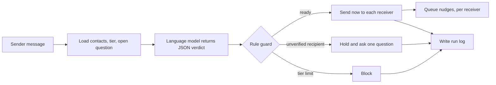

# Architecture

## Principle
The language model does one thing: turn one message into a structured routing decision. It does not send anything, store anything or decide anything the rules forbid. Everything else is ordinary code and a database.

```
sender message --> [context: sender's contacts, tier, open question]
                       |
                       v
                  language model  --JSON-->  rule guard  -->  apply
                  (prompts/)                 (tier caps,       send now / hold / block
                                             unverified,       queue nudges
                                             relay leaks)      write run log
```

## Diagram



## What is built (the simulator, `prototype/index.html`)
- **Prompt and schema** (`prompts/`). Verdict is one of `ready`, `needs_verification`, `blocked_by_tier`, `no_action`.
- **Verification hold.** An unknown or unverified recipient freezes the whole message. One person is asked about at a time. The held message is re-run after the answer.
- **Rule guard.** Free tier: at most 2 recipients per message and 4 unique contacts per 24 hours, no broadcasts. Paid tier: up to 10 individuals. A delivery to an unverified or unknown contact is rewritten as a hold.
- **Per-recipient nudges.** Each delivery carries its own nudge: none, exactly at the time the sender will act, or 15 minutes before the earliest time given. The app does the time arithmetic. Receivers without a nudge never see a nudge message.
- **Relay check.** Warns when a receiver's message contains instruction words (kahibu, bolo, nudge, remind...) or another recipient's name.
- **Channel state.** Each contact is Hot (automatic relay) or Cold (assist mode: a wa.me link the sender sends from their own phone).
- **Run ledger.** Every run is logged with time, verdict, recipients, nudges and guard notes, with CSV export.

## What is planned (live version, not built)
1. **WhatsApp Cloud API** receives messages and sends replies. Free-form messages may only be sent inside the 24-hour window that opens when a person messages the service number; outside it, approved templates are required and charged. Hot contacts are those whose window is open. Everyone else is assist mode.
2. **n8n** webhook workflow: load the sender's contacts from the database, call the model, run the guard in a code step, send, record.
3. **Supabase (PostgreSQL)** holds people, roles, connections and the run log (`supabase/schema.sql`). A unique constraint on the WhatsApp message ID makes webhook retries harmless.
4. **Scheduled nudges.** A `scheduled_nudges` table and a workflow that runs every minute and sends those that are due, skipping receivers whose window has closed.
5. **Institutional tier** for care homes and clinics, after a consent and data-protection design.

## Scaling limits we know about
Cost and latency of one model call per message, accuracy on Odia, WhatsApp messaging limits and template costs, and running the workflow engine on a single machine.
